# UX review (GitLab #132)

The owner asked for the app to become more intuitive and more appealing.
This is the review, not the redesign: a prioritised list for the owner to
choose from. Every finding has a screenshot, the problem, a concrete
suggestion, and an estimate of **effort** and **impact** (S/M/L). The
follow-up issues are created from the findings the owner picks.

Reviewed on 2026-10-22 against `main` at a2d859f, in German (de-DE), with
the review data described under [How to rerun](#how-to-rerun).

## Top 10 by impact

| #   | Finding                                                                                     | Effort | Impact |
| --- | ------------------------------------------------------------------------------------------- | ------ | ------ |
| 1   | [Booking income can't be switched on in the app](#f1)                                       | S      | L      |
| 2   | [The ledger and the categories speak English and show ids](#f2)                             | S–M    | L      |
| 3   | [Settings: one long page, each property's settings spread over six cards](#f3)              | M      | L      |
| 4   | [Public property page: no button to book, little trust, no identity](#f4)                   | M–L    | L      |
| 5   | [Booking status is plain text everywhere](#f5)                                              | S      | M–L    |
| 6   | [Phone: the page is wider than the screen; filters and controls fill the first screen](#f6) | S–M    | M–L    |
| 7   | [Publishing a property is a checkbox in another dialog](#f7)                                | M      | M      |
| 8   | [Guest page: the bank details come last](#f8)                                               | S      | M      |
| 9   | [Amounts with a decimal point; "today" is yesterday after midnight](#f9)                    | S      | M      |
| 10  | [Platform bookings: no "Bezahlt", and the website's payment rules shown for them](#f10)     | S–M    | M      |

Ranked by how often the problem hits the owner or a guest and how much it
costs them (wrong numbers, a lost request, an abandoned task), then by
effort. Items 1, 2, 5, 8 and 9 are small and could ship together.

## The main tasks, walked

Each task was walked the way the owner (desktop) or a guest (phone) would
do it, starting from the calendar or the public start page. The walks are
scripted (`e2e/ux/tasks.spec.ts`) so they can be rerun after a change: the
pictures of every step and the counts are under
`docs/ux-review/screens/tasks/<task>/`.

| Task                                    | Clicks | Fields typed | Pages | Where I hesitated                                                                                                           |
| --------------------------------------- | -----: | -----------: | ----: | --------------------------------------------------------------------------------------------------------------------------- |
| Enter a booking by hand (Airbnb)        |     10 |            5 |     3 | Status offers only "Anfrage"/"Bestätigt", not "Bezahlt" ([F10](#f10)); the price fields show "70.00".                       |
| Answer a request and record the deposit |      6 |            0 |     4 | None on the requests page: it is the best screen in the app. The booking page shows the status as plain text ([F5](#f5)).   |
| Enter an expense with a receipt         |      9 |            2 |     2 | Categories in English ([F2](#f2)); the date defaults to yesterday after midnight ([F9](#f9)).                               |
| Set up a recurring cost                 |     10 |            2 |     3 | The interval field is labelled "Alle"; categories in English.                                                               |
| Set seasonal prices and a discount      |     11 |            6 |     3 | Prices live under Einstellungen → a small "Preise" link in the property row ([F3](#f3)); the base price is elsewhere again. |
| Check the month on the dashboard        |      2 |            0 |     2 | Booking income is missing for hand-entered bookings ([F1](#f1)); the income differs from Finanzen without saying why.       |
| Publish a property                      |     11 |            9 |     3 | Publishing is a checkbox at the bottom of the edit dialog ([F7](#f7)); nothing stops publishing an empty listing.           |
| Guest: find dates, see the price, ask   |      8 |            4 |     2 | No button to book until a date is tapped ([F4](#f4)); "Gäste" is asked only after the price.                                |
| Guest: use the guest page               |      1 |            0 |     1 | The bank details are below six questions ([F8](#f8)).                                                                       |

Clicks count every click or tap, including opening a select and picking an
option (two). Fields count text typed. Pages count the distinct addresses
visited, including the start.

## Findings

### F1. Booking income can't be switched on in the app {#f1}

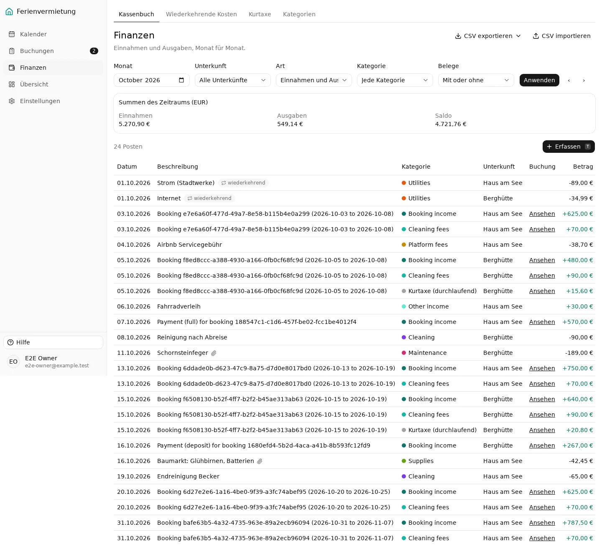

**Problem.** Bookings become ledger income only when "income automation"
is on for the property. It is off for every new property, and there is no
switch anywhere in the app. The user guide says it "is set up through the
API for now". So a booking entered by hand (Airbnb, phone, Booking.com)
never appears as income, and the dashboard's Umsatz, Gewinn and
Gewinnmarge are too low. Only bookings with recorded payments count. The
owner has no way to see why. (The review data switches it on, so the
screenshots show the intended state.)

**Suggestion.** Turn it on by default for new properties and existing ones
(a migration), and add the switch with its "bei Stornierung" choice to the
property's settings ([F3](#f3)), worded as "Buchungen automatisch als
Einnahmen ins Kassenbuch eintragen".

Effort **S** · Impact **L**

### F2. The ledger and the categories speak English and show ids {#f2}


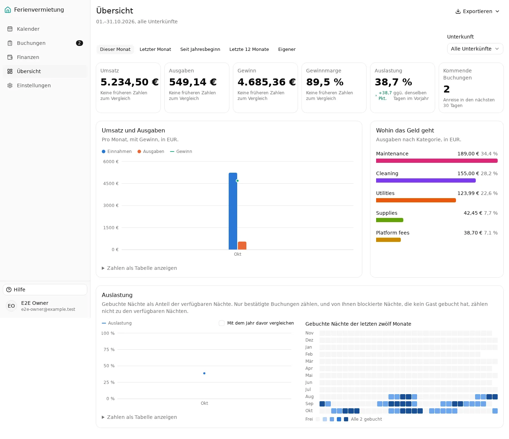

**Problem.**

- The entries the app writes are described as
  `Booking 2249bcf8-f9b4-4eb1-aa88-14f5ae257b4e (2026-10-03 to 2026-10-08)`
  and `Payment (full) for booking d6217d08-…`: English, with a database id,
  on the owner's most-used finance screen.
- The default categories are English: Booking income, Cleaning fees,
  Utilities, Maintenance, Platform fees, Supplies, Insurance, Taxes, Other
  expenses. Only "Kurtaxe (durchlaufend)" is German. They show in the
  ledger, in every category picker ("Cleaning (Ausgabe)"), in the recurring
  costs and in the dashboard's "Wohin das Geld geht".
- On the guest page the bank transfer reference is "Booking HWVB-4R52".

This is the owner's original complaint ("couldn't find", "picked the wrong
category"): a German user scanning for "Nebenkosten" or "Reinigung" doesn't
find "Utilities" or "Cleaning".

**Suggestion.** Show system categories by their `systemKey` through the
message catalogue (Buchungseinnahmen, Reinigungsgebühren, Sonstige
Einnahmen, Reinigung, Instandhaltung, Nebenkosten, Plattformgebühren,
Verbrauchsmaterial, Versicherung, Steuern, Sonstige Ausgaben), unless the
owner renamed them. Render generated entries from their kind instead of
storing English text: "Buchung Greta Lindqvist, 08.–12.11." and
"Anzahlung Miriam Schulte", with the guest's name taken from the linked
booking at display time (the stored description stays free of personal
data). Use "Buchung HWVB-4R52" as the transfer reference for German guests.

Effort **S–M** · Impact **L**

### F3. Settings: one long page, each property's settings spread over six cards {#f3}

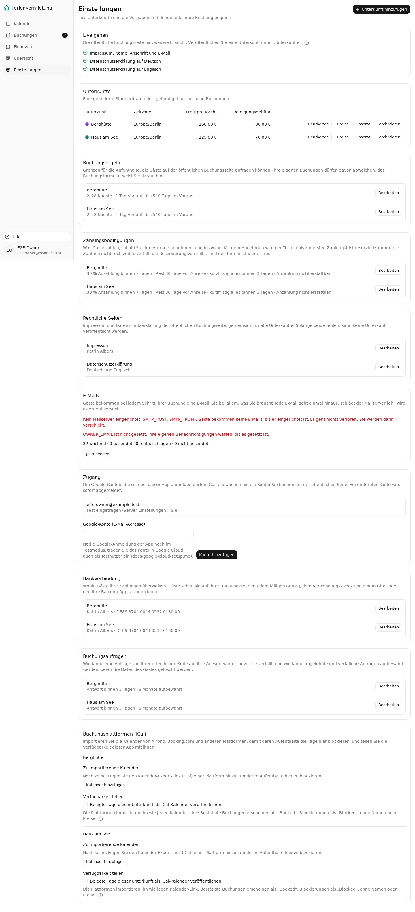

**Problem.** Einstellungen is one page, 3,158 px tall at desktop width,
with nine cards. What belongs to one property is spread over six of them:
the property row (with small "Preise" and "Inserat" text links),
Buchungsregeln, Zahlungsbedingungen, Bankverbindung, Buchungsanfragen and
iCal. The cancellation rule is split between Zahlungsbedingungen ("Anzahlung
nicht erstattbar") and the Preise page (Staffel). The base price is edited
in the property dialog, while seasons are on the Preise page, whose intro
has to explain where the base price lives. To change anything about "Haus
am See", the owner has to know which card holds it. With a third property
every card grows.

**Suggestion.** One page per property, reached from Einstellungen →
Unterkünfte (the whole row clickable), with tabs:

- **Inserat**: photos, texts, check-in times, and publishing ([F7](#f7)).
- **Preise**: base price, cleaning fee, seasons, discounts and Kurtaxe.
- **Buchung & Zahlung**: booking rules, payment terms, cancellation, bank
  details, request deadlines, and booking income ([F1](#f1)).
- **Kalender**: the iCal import and export.

Einstellungen keeps only what is shared: Rechtliche Seiten, E-Mails,
Zugang. That page would be about a third of its current length.

Effort **M** · Impact **L**

### F4. Public property page: no button to book, little trust, no identity {#f4}

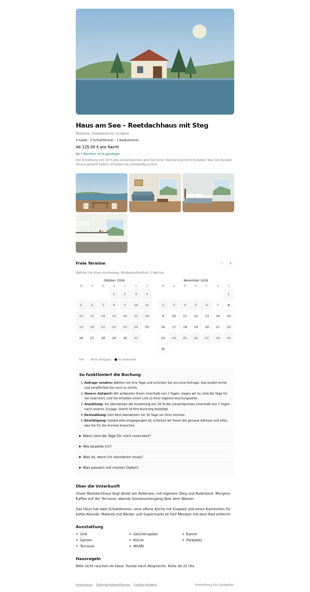
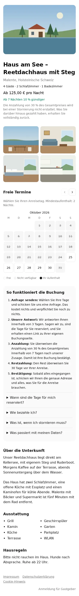

**Problem.**

- There is no button to book. A guest has to find the calendar (below the
  photos, more than a screen down on a phone) and tap a day. The form
  appears only after two taps and "Diese Daten anfragen".
- The first sentence after the price is that the deposit is not refunded.
  It's honest, but it's the first thing read, before any reason to book.
- On desktop the page is a 540 px column on a 1,440 px screen. The photos
  are one hero and small thumbnails that can't be opened larger.
- Nothing says who rents the house. "Die Vermieterin oder der Vermieter"
  in the price note reads like a template. Booking directly (no platform
  fee, a person who answers) is the main reason to book here, and the page
  doesn't say it.
- On the start page only the title is a link: tapping the photo does
  nothing.
- The look is the admin's: system font, no colour, no identity.

**Suggestion.** See [Visual direction](#visual-direction) and the mocks:
photos first (a mosaic, then a gallery), a booking card with price, dates,
guests and one clear button ("Freie Termine ansehen"), sticky on desktop
and as a bottom bar on the phone. The cancellation rule moves into the
card's details. Add a short note from the host, and say plainly why
booking direct is good. Make the whole start page card a link.

Effort **M–L** · Impact **L**

### F5. Booking status is plain text everywhere {#f5}

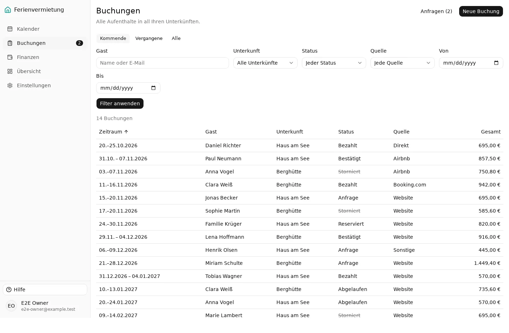
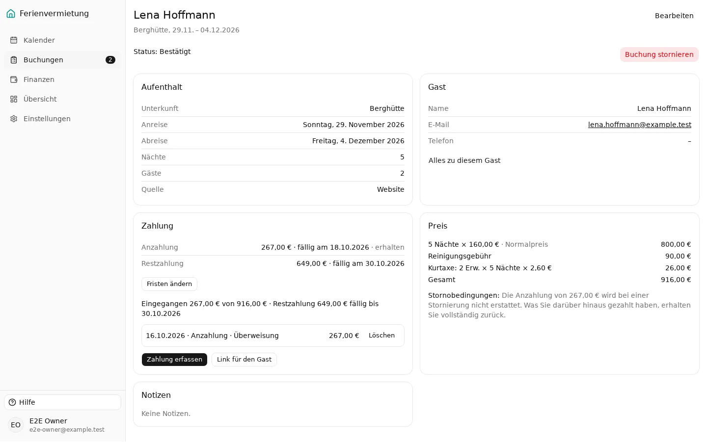

**Problem.** The list shows "Anfrage", "Reserviert", "Bestätigt",
"Bezahlt", "Abgelaufen" and "Storniert" in the same grey text; only
Storniert is struck through. The booking page says "Status: Bestätigt" in
body text, top left, while the red "Buchung stornieren" top right is the
most visible thing on the page. The stylesheet already has status colours
(`--color-status-*`), but they aren't used here. In the calendar legend,
the property colours and the status share the same swatches ("Bestätigt"
is the purple of Berghütte).

**Suggestion.** A status badge (colour plus label, as #91 requires) in the
list, the phone cards and the booking page header, next to the title.
Show what's next on the booking page ("Anzahlung 423,90 € fällig bis
28.10."), and move "Buchung stornieren" into a "Weitere Aktionen" menu.
Hide cancelled and expired bookings from "Kommende" by default.

Effort **S** · Impact **M–L**

### F6. Phone: the page is wider than the screen; filters and controls fill the first screen {#f6}

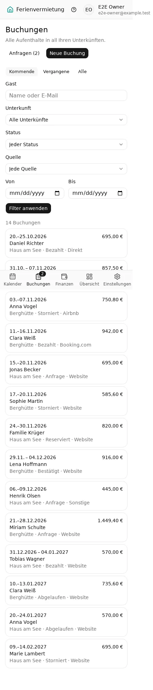
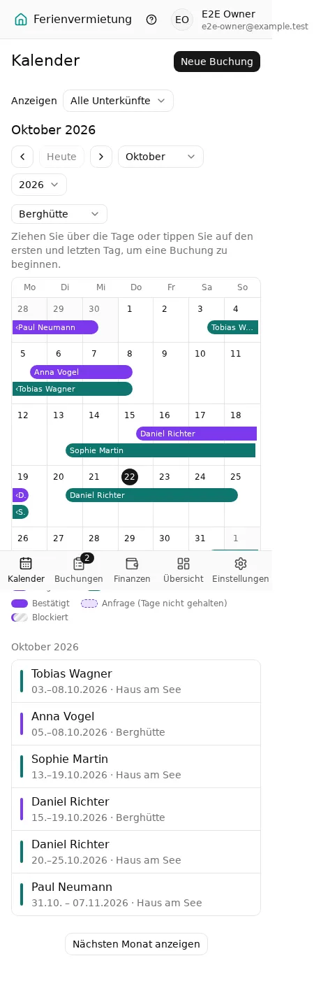

**Problem.**

- The header shows the avatar, the name and the full e-mail address. On a
  390 px phone the page becomes 450 px wide, so every admin page scrolls
  sideways and the e-mail is cut off.
- Buchungen: six filter fields and "Filter anwenden" take the whole first
  screen before the first booking.
- Kalender: four rows of controls (Anzeigen, month navigation, year, the
  "drag to book" property picker and its hint) before the grid. The bars
  in the grid are too thin to read or tap; the month list below it is
  what's actually usable.
- Finanzen: the tabs sit above the page title, and the fourth one
  ("Kurtaxe") is cut off without a hint that the row scrolls.
- The help page is the whole user guide on one page: 29,000 px on a phone.

**Suggestion.** In the phone header, show only the avatar; the menu has
the rest. Put the filters behind a "Filter" button (a sheet) showing how
many are active. Apply filters as they change, which also removes "Filter
anwenden" on desktop. On the phone calendar, open on the month list, with
the grid one tap away. Open the help page at the section for the current
page, with a table of contents.

Effort **S–M** · Impact **M–L**

### F7. Publishing a property is a checkbox in another dialog {#f7}

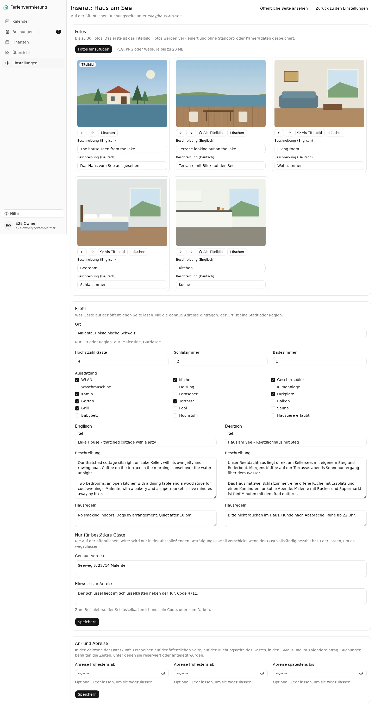
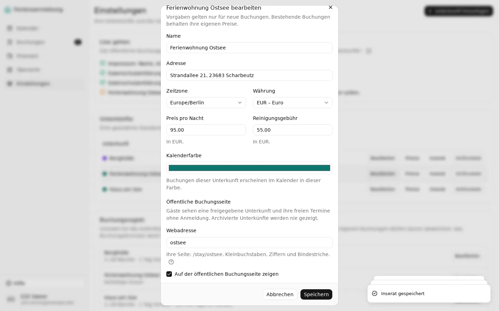

**Problem.** The owner prepares the listing on the Inserat page (photos,
texts, times), but publishes it with "Auf der öffentlichen Buchungsseite
zeigen" at the bottom of the property dialog, under "Kalenderfarbe". The
dialog also asks for the web address ("Webadresse", placeholder
"lake-house"). A property can be published with no photos and no text,
which gives guests an empty page. On a 900 px high screen the dialog's
title is cut off at the top.

**Suggestion.** A "Veröffentlichen" switch at the top of the Inserat page
with a checklist (at least one photo, a German title and description,
the maximum number of guests, legal pages), which is disabled until the
list is complete. Take the web address from the name ("ferienwohnung-ostsee"),
editable. Show the full public link, with a copy button.

Effort **M** · Impact **M**

### F8. Guest page: the bank details come last {#f8}

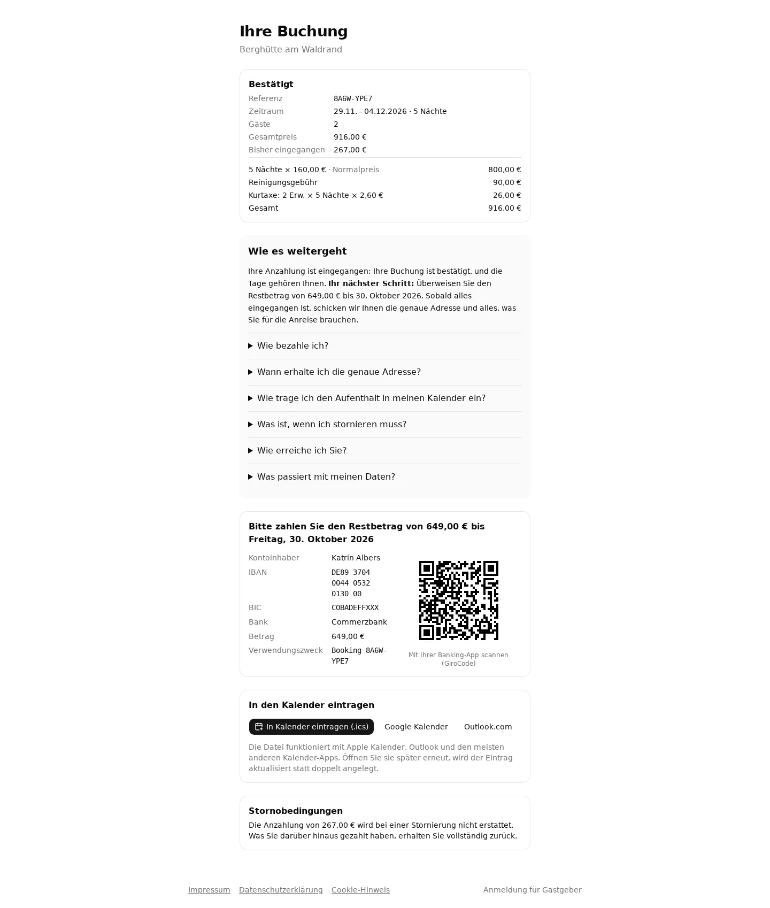

**Problem.** The guest's one job on this page is to pay. The bank details
come after the price breakdown and six questions ("Wie bezahle ich?" …).
The IBAN wraps over three lines and can't be copied in one go. The total
appears twice. The status ("Bestätigt") is a small heading (already noted
as a follow-up).

**Suggestion.** Order the page as: status in large type, then what to do
now (amount, deadline, bank details with copy buttons for IBAN, amount
and reference, and the GiroCode), then the stay, then the questions. Show
the IBAN in groups of four on one line.

Effort **S** · Impact **M**

### F9. Amounts with a decimal point; "today" is yesterday after midnight {#f9}

**Problem.**

- Prefilled amounts use a decimal point: "70.00" (Reinigungsgebühr in the
  booking form), "423.90" (payment dialog), "95.00" (property dialog). The
  placeholders are "0.00". Typing "23,80" works, but the app itself writes
  the English form.
- Several "today"s are computed in UTC: the calendar's today marker
  (`todayUtc()` in the calendar page), the first due date of a recurring
  cost (`rule-dialog.tsx`), the expense date, and the first month of the
  public calendar. Between midnight and 1 or 2 a.m. German time they show
  yesterday. The screenshots were taken at 01:30 and show 21.10.

**Suggestion.** Format prefilled amounts with the locale ("70,00"), and
use the property's (or the owner's) time zone for "today", as the
services already do (`todayIn`).

Effort **S** · Impact **M**

### F10. Platform bookings: no "Bezahlt", and the website's payment rules shown for them {#f10}

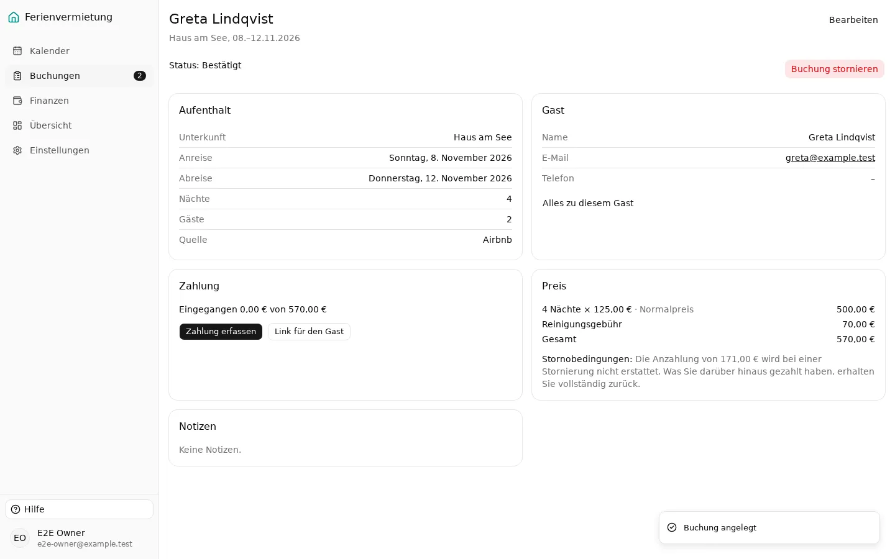

**Problem.** Most hand-entered bookings come from Airbnb or Booking.com,
already paid there. The form offers only "Anfrage" or "Bestätigt", so the
owner can't record them as paid, and the default is "Anfrage" with
1 guest. The saved booking then shows the website's rules: "Eingegangen
0,00 € von 570,00 €", a "Link für den Gast", and "Die Anzahlung von
171,00 € wird bei einer Stornierung nicht erstattet". None of these apply
to a booking the platform handles.

**Suggestion.** When the source is a platform, offer "Bezahlt (über die
Plattform)" and default to it, and hide the payment section, the guest
link and the cancellation note (or replace them with "Zahlung und
Stornierung laufen über Airbnb"). Default "Gäste" to 2.

Effort **S–M** · Impact **M**

### More findings

| Area         | Finding                                                                                                                                                                                                                                     | Suggestion                                                                                                                                                       | Effort | Impact |
| ------------ | ------------------------------------------------------------------------------------------------------------------------------------------------------------------------------------------------------------------------------------------- | ---------------------------------------------------------------------------------------------------------------------------------------------------------------- | ------ | ------ |
| Wording      | Einstellungen → E-Mails shows `SMTP_HOST, SMTP_FROM` and `OWNER_EMAIL ist nicht gesetzt` in red; Zugang points to `docs/google-cloud-setup.md`. ([screenshot](ux-review/screens/desktop/admin-settings.webp))                               | "E-Mails sind noch nicht eingerichtet: Gäste bekommen erst E-Mails, wenn Ihr Administrator den Mailserver eingetragen hat." Keep the variable names in the docs. | S      | M      |
| Wording      | "Live gehen" (Einstellungen), "Alle" as the label of the interval in recurring costs, "Webadresse" placeholder "lake-house".                                                                                                                | "Veröffentlichen", "Wiederholt sich", a German example.                                                                                                          | S      | S      |
| Wording      | The time zone picker lists all ~400 IANA names ("Africa/Abidjan" first); the settings table shows "Europe/Berlin".                                                                                                                          | Default to the owner's, show "Deutschland (Berlin)", hide it under "Mehr".                                                                                       | S      | S      |
| Dashboard    | Umsatz (5.234,50 €) and Finanzen → Einnahmen (5.270,90 €) differ by the Kurtaxe, without a word. "Keine früheren Zahlen zum Vergleich" repeats under four tiles. ([screenshot](ux-review/screens/desktop/admin-dashboard.webp))             | "ohne Kurtaxe" under Umsatz; say "no comparison yet" once.                                                                                                       | S      | M      |
| Finanzen     | "CSV exportieren/importieren" sit in the header; "Erfassen", the everyday action, is smaller and lower. The tabs are above the heading, and the heading ("Finanzen") doesn't match the selected tab ("Kassenbuch").                         | "Posten erfassen" as the header's primary button, CSV under a menu; tabs below the heading.                                                                      | S      | M      |
| Finanzen     | Recurring costs: each row has three buttons (Bearbeiten, Pausieren, Löschen), and "Zurück zum Kassenbuch" duplicates the tab. ([screenshot](ux-review/screens/desktop/admin-finance-recurring.webp))                                        | Row opens the rule; pause and delete in a menu; drop the back link.                                                                                              | S      | S      |
| Forms        | Filters (Buchungen, Finanzen) need "Filter anwenden"/"Anwenden"; on desktop "Bis" wraps onto its own row.                                                                                                                                   | Apply on change; one row.                                                                                                                                        | S      | S      |
| Inserat      | English fields come before German everywhere (texts, photo descriptions), though the owner and most guests are German. Photo descriptions save without any visible feedback. ([screenshot](ux-review/screens/desktop/admin-listing.webp))   | German first; a small "gespeichert" after each field.                                                                                                            | S      | S      |
| Calendar     | Two property pickers on one screen ("Anzeigen" and the one for drag-to-book), plus a long hint. The legend mixes property colours and status. ([screenshot](ux-review/screens/desktop/admin-calendar.webp))                                 | Ask for the property when a drag starts on "Alle"; status as a pattern or icon, not a colour that collides.                                                      | M      | S      |
| Public       | "Gäste" is asked in the form after the price is shown; with Kurtaxe the price changes with guests.                                                                                                                                          | Ask guests with the dates (booking card, [mocks](#visual-direction)).                                                                                            | S      | S      |
| Keyboard     | No "skip to content" link: every admin page starts with 8 tab stops through the sidebar. On the public calendar every day is its own tab stop (30+ to get past one month). Focus is visible everywhere, which is good.                      | Skip link; the calendar as one grid with arrow keys (roving tabindex).                                                                                           | S–M    | M      |
| Dark mode    | `globals.css` has dark tokens, but nothing ever sets the `dark` class, so nobody sees dark mode. The `*-dark` screenshots add the class to preview them; the admin mostly works, but charts and status colours were not checked against it. | Follow `prefers-color-scheme`, after a contrast pass.                                                                                                            | S–M    | S      |
| Empty states | Good: the empty calendar, finance and settings explain what to do and offer the first step, and the "Live gehen" checklist lists what's missing. ([screenshot](ux-review/screens/desktop/admin-settings.webp))                              | Keep; reuse the checklist idea for publishing ([F7](#f7)).                                                                                                       | –      | –      |
| Feedback     | Good: every save shows a toast that names the action ("Buchung angelegt", "Zahlung erfasst"), and the requests page updates in place.                                                                                                       | Keep.                                                                                                                                                            | –      | –      |

## Visual direction

A proposal for the public site only; the admin stays as it is apart from
the findings above. The mocks are static HTML in
`docs/ux-review/mocks/property.html`, using the review's painted
placeholder photos; real photos will carry much more of the page.

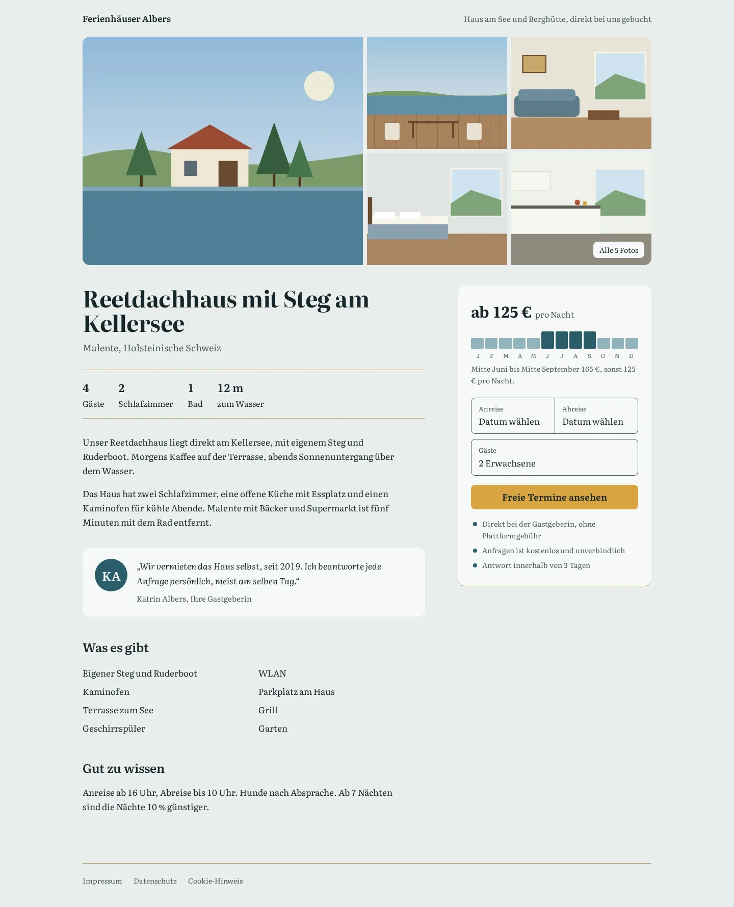
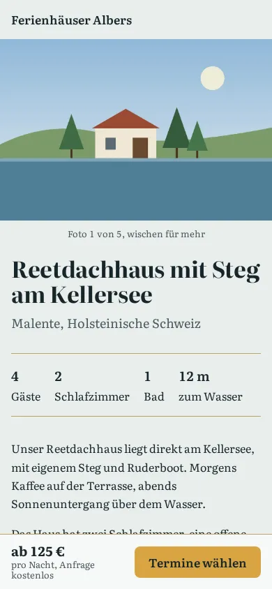

- **Idea.** A private host, not a platform: the page should feel like the
  owner's own place by the lake, with the house first and a person behind
  it. The memorable part is one small device the platforms don't have: a
  strip showing the price through the year, taken from the admin's season
  view, so a guest sees at a glance when a stay is cheaper.
- **Typography.** One family, Literata (a reading serif with optical
  sizes, open licence, good German diacritics): a large, tight setting for
  the title, a relaxed one for the text (17 px, line height 1.65, lines
  under 65 characters), tabular figures for prices. Self-hosted in two weights, so no
  third-party request; its size has to fit the Lighthouse budget.
- **Colour.** Mist `#E9EEEC` as the background (cool, from the water, not
  the usual cream), ink `#17262B`, lake `#2B5D6B` for accents and the
  season strip, reed `#B9A66A` for hairlines, and one warm colour, thatch
  `#D9A441`, used only for the button that books.
- **Imagery.** Photos first: a five-photo mosaic on desktop, a swipeable
  gallery on the phone, all opening to full size. Ask the owner for one
  wide outside photo in daylight as the first one.
- **Layout.** The text column on the left; on the right a booking card with
  the price, the year strip, dates, guests, the button and three short
  assurances ("Direkt bei der Gastgeberin, ohne Plattformgebühr",
  "Anfragen ist kostenlos und unverbindlich", "Antwort innerhalb von 3
  Tagen"). On the phone, a bottom bar with the price and "Termine wählen".
  Facts ("4 Gäste", "2 Schlafzimmer") as a row of numbers instead of a
  dotted string. A short note from the host, with her name.

The rules for the public pages stay: no cookies, the Lighthouse budgets,
and no exact address (the mock shows only the town).

## Small fixes in this MR

- The close button of dialogs and sheets was labelled "Close" in English
  for screen readers (and in `DialogFooter`); it now uses the catalogue's
  "Schließen"/"Close".
- The photo upload input on the Inserat page had no label, so screen
  readers announced the browser's "Choose File"; it now has "Fotos
  hinzufügen".

## How to rerun

```bash
npm run ux:screenshots
```

This resets its own database (`vacation_home_ux_e2e`, next to the e2e
one), seeds it with `scripts/ux/seed.ts`, builds and starts the app, then
runs three specs:

- `e2e/ux/pages.spec.ts`: every main page, admin and public, at 390 and
  1,440 px, light and dark, into `docs/ux-review/screens/<variant>/`.
- `e2e/ux/tasks.spec.ts`: the task walks, with their counts.
- `e2e/ux/mocks.spec.ts`: the mocks.

It needs the same PostgreSQL as the e2e run (`docker compose up db`).
`UX_REUSE_SERVER=1` reuses a server already running on port 3100, seeded
the same way. The seed refuses any database not named `*_ux_e2e` on a local
host. The data is relative to today: two listed properties with photos,
seasons, a discount and Kurtaxe; bookings in every status, including
website requests that were accepted, paid, declined, cancelled and left to
lapse; six weeks of income and expenses with receipt photos; four
recurring costs. The photos and receipts are drawn by `scripts/ux/images.ts`,
so no stock photos are in the repository.

Notes on the pictures:

- Fonts: the app uses the system font stack. These screenshots were taken
  on Linux with Liberation Sans; on the owner's Windows machine it's Segoe
  UI.
- Date fields show "mm/dd/yyyy" and the month field "October 2026" because
  the headless browser ignores the page language for native inputs; a
  German browser shows "TT.MM.JJJJ". Not a finding.
- Full-page phone pictures show the bottom navigation bar partway down: it
  is fixed to the screen, and a full-page picture is taken as one tall
  screen.
- Pages taller than 16,383 px are cut there (a WebP limit). The help page
  is photographed as its first screen only.
